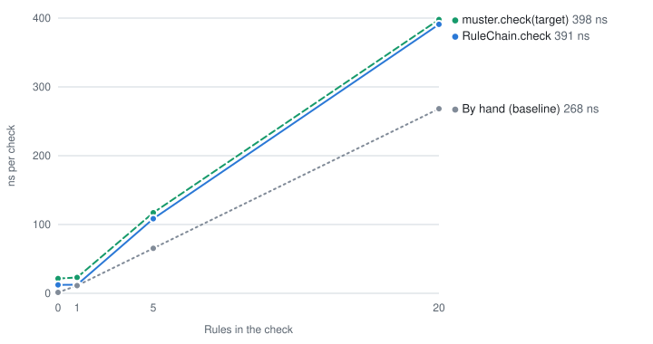

# Muster

[](https://scorecard.dev/viewer/?uri=github.com/mryakar/muster)

> Does your request pass muster?

Business rules for layered Java applications, checked before your service method runs — inside the
transaction, outside your service code.

## Status

Muster is in early development, and its API will change until 1.0.0. The latest release is 0.3.0,
with the core and the Spring Boot starter. [The documentation](https://mryakar.github.io/muster/)
has a guide to the starter and one without Spring, the reference and the Javadoc, for each release
from 0.4.0 on and for the main branch, in English and in Turkish. The [roadmap](ROADMAP.md) says what follows.

## Why

Service methods tend to start with a wall of checks: does this record exist, is that name already
taken, is the task in the right state. Muster moves each of those checks into its own rule class.
With the Spring Boot starter, rules run before the first line of the service method, inside its
transaction, so adding a rule never means editing the service, and a violated rule reaches the
client as problem details in its language.

Format checks on a single field (blank, negative, malformed) stay with Jakarta Bean Validation.
Muster is for rules that need the database and the context of the operation.

## Installation

Muster is on Maven Central. Import the BOM, which keeps the versions of the Muster modules in
line, and add the Spring Boot starter, or the core alone without Spring, without a version.

Gradle:

```kotlin
dependencies {
  implementation(platform("me.yakar.muster:muster-bom:0.3.0"))
  implementation("me.yakar.muster:muster-spring-boot-starter") // or muster-core without Spring
}
```

Maven:

```xml
<dependencyManagement>
  <dependencies>
    <dependency>
      <groupId>me.yakar.muster</groupId>
      <artifactId>muster-bom</artifactId>
      <version>0.3.0</version>
      <type>pom</type>
      <scope>import</scope>
    </dependency>
  </dependencies>
</dependencyManagement>

<dependencies>
  <dependency>
    <groupId>me.yakar.muster</groupId>
    <artifactId>muster-spring-boot-starter</artifactId> <!-- or muster-core without Spring -->
  </dependency>
</dependencies>
```

Muster needs Java 21 or later, and the starter Spring Boot 4.0.9 or later. The core is the Java
module `me.yakar.muster`; used without Maven or Gradle, it also needs `org.jspecify:jspecify` to
compile. Releases are signed; [SECURITY.md](SECURITY.md#verifying-a-release) says how to verify
them.

## A first rule

With the Spring Boot starter, a rule is a class with an id. The starter finds rule classes in the
packages of the application, as Spring Boot finds entities, and creates each one as a bean, so it
gets its dependencies through the constructor:

```java
@Rule(id = "vehicle.name-unique")
public class VehicleNameUnique implements BusinessRule<VehicleFields> {

  private final VehicleRepository vehicles;

  public VehicleNameUnique(VehicleRepository vehicles) {
    this.vehicles = vehicles;
  }

  @Override
  public RuleResult check(VehicleFields input, RuleContext ctx) {
    return vehicles.isTaken(input.name())
        ? RuleResult.failed(taken(ctx, input.name()))
        : RuleResult.passed();
  }

  private static Violation taken(RuleContext ctx, String name) {
    return ctx.violation()
        .clientArg("name", name)
        .target("name")
        .category(Category.CONFLICT)
        .build();
  }
}
```

The command the rule checks is a rule target, and the service method that takes it says nothing
at all: its rules run before its first line, inside its transaction, and if one fails the method
does not run.

```java
public interface VehicleFields extends RuleTarget {
  String name();
}

public record CreateVehicle(@NotBlank String name, @NotBlank String plate)
    implements VehicleFields {}

@Service
@Validated
public class VehicleService {

  @Transactional
  public Vehicle create(@Valid CreateVehicle command) { … }
}
```

A violation becomes problem details in the language of the client, with the message that the
application's `messages_tr.properties` gives the code of the rule, and no line of error handling:

```
POST /vehicles                Accept-Language: tr-TR
409 Conflict                  Content-Type: application/problem+json
{
  "title": "İş kuralı ihlali",
  "status": 409,
  "instance": "/vehicles",
  "violations": [
    {
      "code": "vehicle.name-unique",
      "message": "ilgaz adı kullanılıyor",
      "target": "name",
      "category": "CONFLICT",
      "args": { "name": "ilgaz" }
    }
  ]
}
```

[The quick start](https://mryakar.github.io/muster/muster/current/start/quick-start-spring.html)
builds this in four steps, from an example application that runs on every build of Muster, and
[the guide to the starter](https://mryakar.github.io/muster/muster/current/spring/getting-started.html)
follows the same application further: choosing the rules of a method, checking a list of commands
in one call, transactions, the fields of the answer, the caller and the locale, configuration,
observability and testing.

## Without Spring

The core needs no framework: build one `Muster` for the application, then check inputs against
chains of rules, by type or in the order you list them, and a collection in one call.
[The quick start without Spring](https://mryakar.github.io/muster/muster/current/start/quick-start-java.html)
and [the guide](https://mryakar.github.io/muster/muster/current/core/rules.html) show how, from the
first rule to the answer to a rejected call.

## Performance

<picture>
  <source media="(prefers-color-scheme: dark)" srcset="docs/modules/ROOT/images/benchmarks/check-cost-dark.svg">
  
</picture>

Muster checks and orders the rules of a chain once, when the chain is created, and does no
reflection while it checks. A passing check of 20 rules adds about 130 ns to calling them by hand,
and the Spring Boot starter about 130 ns to a call of an advised service method, most of it Spring
AOP's proxy. [The benchmarks](https://mryakar.github.io/muster/muster/current/reference/benchmarks.html)
give the machine, the method, every result and the budget a change is held to.

## Modules

| Module | Purpose |
|---|---|
| `muster-core` | Rule contract, engine and plain Java API. Its only dependency is the JSpecify annotations. |
| `muster-spring-boot-starter` | Spring Boot integration: rules around service methods and inside their transaction, problem details, messages, configuration. |
| `muster-bom` | Aligns the versions of the Muster modules. |
| `muster-examples` | Complete example applications, with Spring Boot and without, which the documentation includes its samples from; also the test of the published artifacts. Not published. |
| `muster-benchmarks` | JMH benchmarks of what Muster adds to a call and to the startup of an application, with [the results](https://mryakar.github.io/muster/muster/current/reference/benchmarks.html). Not published. |

## Contributing

[CONTRIBUTING.md](CONTRIBUTING.md) says how to build and test Muster. Report security issues as
described in [SECURITY.md](SECURITY.md).

## License

Muster is licensed under the [Apache License 2.0](LICENSE).
