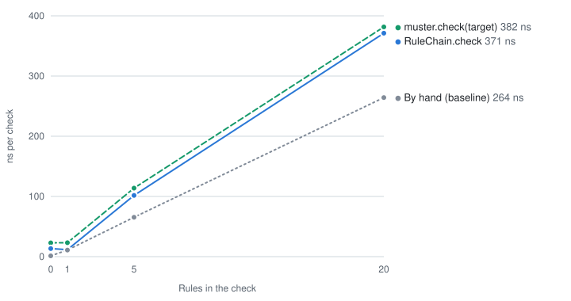

# Muster

> Does your request pass muster?

Business rules for layered Java applications, checked before your service method runs — inside the
transaction, outside your service code.

## Status

Muster is in early development, and its API will change until 1.0.0. The latest release is 0.2.0,
with the core and the Spring Boot starter. The [roadmap](ROADMAP.md) says what follows.

## Why

Service methods tend to start with a wall of checks: does this record exist, is that name already
taken, is the task in the right state. Muster moves each of those checks into its own rule class.
With the Spring Boot starter, rules run before the first line of the service method, inside its
transaction, so adding a rule never means editing the service, and a violated rule reaches the
client as problem details in its language.

Format checks on a single field (blank, negative, malformed) stay with Jakarta Bean Validation.
Muster is for rules that need the database and the context of the operation.

## Installation

Muster is on Maven Central. Import the BOM, which keeps the versions of the Muster modules in
line, and add the Spring Boot starter, or the core alone without Spring, without a version.

Gradle:

```kotlin
dependencies {
  implementation(platform("me.yakar.muster:muster-bom:0.2.0"))
  implementation("me.yakar.muster:muster-spring-boot-starter") // or muster-core without Spring
}
```

Maven:

```xml
<dependencyManagement>
  <dependencies>
    <dependency>
      <groupId>me.yakar.muster</groupId>
      <artifactId>muster-bom</artifactId>
      <version>0.2.0</version>
      <type>pom</type>
      <scope>import</scope>
    </dependency>
  </dependencies>
</dependencyManagement>

<dependencies>
  <dependency>
    <groupId>me.yakar.muster</groupId>
    <artifactId>muster-spring-boot-starter</artifactId> <!-- or muster-core without Spring -->
  </dependency>
</dependencies>
```

Muster needs Java 21 or later, and the starter Spring Boot 4.0.8 or later. The core is the Java
module `me.yakar.muster`; used without Maven or Gradle, it also needs `org.jspecify:jspecify` to
compile. Releases are signed; [SECURITY.md](SECURITY.md#verifying-a-release) says how to verify
them.

## Usage with Spring Boot

A rule is a class with a stable id. It reports violations instead of throwing. The starter finds
rule classes in the packages of the application, as it finds entities, and creates them as beans,
so they need no `@Component` and get their dependencies through the constructor:

```java
@Rule(id = "vehicle.name-unique")
class VehicleNameUnique implements BusinessRule<VehicleFields> {

  private final VehicleRepository vehicles;

  VehicleNameUnique(VehicleRepository vehicles) {
    this.vehicles = vehicles;
  }

  @Override
  public RuleResult check(VehicleFields input, RuleContext ctx) {
    return vehicles.existsByName(input.name())
        ? RuleResult.failed(
            ctx.violation("vehicle.name-taken")
                .clientArg("name", input.name())
                .target("name")
                .category(Category.CONFLICT)
                .build())
        : RuleResult.passed();
  }
}
```

A command that implements `RuleTarget` is checked by every rule whose input type accepts it. The
public methods of a `@Service` that take one check its rules before they run, inside their
transaction, with no call to Muster. Such a method takes the command as its only parameter: one
that takes a rule target among other parameters stops the application.

```java
interface VehicleFields extends RuleTarget {
  String name();
}

record CreateVehicle(String name) implements VehicleFields {}

@Service
class VehicleService {

  @Transactional
  public void create(CreateVehicle command) { … } // VehicleNameUnique runs first

  @Transactional
  @Rules(value = VehicleNotInUse.class, mode = CheckMode.COLLECT_ALL)
  public void delete(Long id) { … } // the listed rules, on any bean
}
```

In a Spring MVC application, a violated rule becomes problem details (RFC 9457). The status
follows the category: 403 for `FORBIDDEN`, 404 for `NOT_FOUND`, 409 for `CONFLICT`, and 422 for
`INVALID_STATE`, no category, or violations of different categories. The message comes from the
message source of the application, in the language of the request, with `{name}` taking the client
argument of that name:

```properties
# messages_tr.properties
vehicle.name-taken={name} adı kullanımda
```

```
POST /vehicles                Accept-Language: tr-TR
409 Conflict                  Content-Type: application/problem+json
{
  "title": "Conflict",
  "status": 409,
  "instance": "/vehicles",
  "violations": [
    {
      "code": "vehicle.name-taken",
      "message": "Atlas adı kullanımda",
      "target": "name",
      "category": "CONFLICT",
      "args": { "name": "Atlas" }
    }
  ]
}
```

The response holds neither the rule id, nor the internal arguments added with `internalArg`, nor
the severity; violations are logged at DEBUG with all three. A controller advice of the application
that names `BusinessRuleViolationException` in an `@ExceptionHandler` replaces the starter's
handler, and can inject its `MessageResolver` bean to resolve the messages.

Rules learn who makes the call from Spring Security, when the application has it, and the locale
from `LocaleContextHolder`; a `Supplier<Principal>` or `Supplier<Locale>` bean replaces either.
Rules can require other rules with `@RequiresRule`. Configuration changes the rest without a new
build; a property set to nothing stops the application:

| Property | Default | |
|---|---|---|
| `muster.mode` | `fail-fast` | `fail-fast` stops at the first violated rule; `collect-all` reports every violation |
| `muster.rules.<rule id>.enabled` | `true` | Switches a rule off, also as an environment variable such as `MUSTER_RULES_VEHICLE_NAMEUNIQUE_ENABLED`; a key under `muster.rules` that switches no rule, such as a misspelled id, stops the application |
| `muster.problem-details.mixed-status` | `422` | The status of violations of different categories, from 400 to 499 |
| `muster.transaction.reorder-advisor` | `true` | Moves the transaction advice ahead of Muster's, so that rules run inside the transaction, unless `@EnableTransactionManagement` has an order of its own |
| `muster.validation.reorder-advisor` | `true` | Moves the method validation advice ahead of Muster's, so that the constraints of a `@Validated` method are checked before its rules and before its transaction, unless the application defines the `MethodValidationPostProcessor` itself |

[`muster-examples/spring-boot`](muster-examples/spring-boot) is a complete application along these
lines.

### Details

**Rules.** Every bean that implements `BusinessRule` is a rule. A rule class outside the packages of
the application joins once it is a bean, for example through `@Bean` or `@Import`. A rule bean must
be a singleton, since Muster creates each rule once and keeps it. A `Muster` bean of the application
replaces the starter's; such an application does not start if it also sets `muster.mode` or a key under
`muster.rules`, which configure only the Muster the starter builds.

**Methods.** `@Rules` is found as Spring finds `@Transactional`: on the method, on the method it
overrides or implements, and as a meta-annotation. A method with rules is public, and neither
static nor final; wrong use stops the application when it starts, as does a transaction advice that
would not run around Muster's. A call through `this` passes no proxy and checks no rules; a call
from one advised method to another checks them again. The constraints of a `@Validated` method are
checked before its rules, and before its transaction, since Muster tells Spring Boot's method
validation to add its advice first; with `muster.validation.reorder-advisor=false`, Spring adds it
last and the rules run before the constraints. Other advice runs as Spring orders it: a `@Cacheable`
hit checks no rules, and an `@Async` method checks them on its own thread, where a violation does
not reach the caller.

**Caller and locale.** The caller is read through the `SecurityContextHolderStrategy` bean of the
application if it has one; a call that is anonymous or not authenticated has no caller. Without a
locale in `LocaleContextHolder`, rules see the default locale of the JVM. A raw `Supplier` bean
replaces neither.

**Messages.** The message of a violation is the template that its code names; without one, it is
the code. A `MessageResolver` bean of the application replaces the starter's. Spring Boot's message
source falls back to the default locale of the JVM, so a server whose default locale is Turkish
answers a French client in Turkish; `spring.messages.fallback-to-system-locale=false` answers from
`messages.properties` instead. `spring.messages.always-use-message-format=true` stops the
application, since `MessageFormat` rejects the `{name}` placeholders.

**Problem details.** They carry no `type`, which stands for `about:blank`. The JSON library of the
application writes the client arguments: make them values, such as strings or numbers, not entities.
The handler has the order 0, as Spring Boot's own problem details do, so a controller advice without
an order that handles every `Exception` does not turn violations into server errors; an advice
ordered before it still can. The handler also answers an exception that a violation causes, unless
an earlier advice handles that exception. A controller advice that names
`BusinessRuleViolationException` in an `@ExceptionHandler`, in the context of the application or a
parent one, replaces the handler for every controller, even if the advice applies to some
controllers only. A controller's own handler comes first anyway. A `@WebMvcTest` gets the handler
and the message resolver, without the rules.

## Usage without Spring

The core needs no framework. Build one `Muster` for the application, then check inputs against
chains of rules, in the order you list them, or by type:

```java
Muster muster = Muster.builder()
    .rules(new VehicleNameUnique(vehicles), new VehiclePlateFormat())
    .caller(() -> CurrentCall.principal()) // your own ThreadLocal, for example
    .locale(() -> CurrentCall.locale())
    .disable(disabledRules()) // ids from your configuration, for example
    .build();

RuleChain<CreateVehicle> create =
    muster.chain(CreateVehicle.class, VehiclePlateFormat.class, VehicleNameUnique.class);
create.check(command); // throws BusinessRuleViolationException if a rule is violated

muster.check(command); // every rule whose input type accepts CreateVehicle
```

What the starter does for you is up to you:

- **Switching rules off:** read the ids from the environment or your configuration and pass them to
  `disable`. `build()` fails if an id is unknown or an enabled rule requires a disabled one.
- **Transactions:** check as the first step inside the transaction of the operation, so that a rule
  reads the data that the operation then changes.
- **Messages:** `MessageResolver.ofResourceBundles(locale -> ResourceBundle.getBundle("com.example.messages", locale))`
  resolves the message of a violation from your resource bundles, with the same `{name}`
  placeholders. Load the bundles in your own module, so that they are found on the module path.
- **HTTP:** map `Violation.category()` to a status yourself, as the starter does: 403 for
  `FORBIDDEN`, 404 for `NOT_FOUND`, 409 for `CONFLICT`, and 422 otherwise. Send the code, the message
  and `clientArgs()`, never the violation itself.

A rule that needs the time takes a `Clock` in its constructor, so that its tests can fix it.
[`muster-examples/plain-java`](muster-examples/plain-java) is a complete application on the module
path.

## Performance

<picture>
  <source media="(prefers-color-scheme: dark)" srcset="docs/benchmarks/check-cost-dark.svg">
  
</picture>

Muster checks and orders the rules of a chain once, when the chain is created, and does no
reflection while it checks. A passing check of 20 rules adds about 110 ns to calling them by hand,
and the Spring Boot starter about 120 ns to a call of an advised service method.
[The benchmarks](docs/benchmarks/README.md) give the machine, the method, every result and the
budget a change is held to.

## Modules

| Module | Purpose |
|---|---|
| `muster-core` | Rule contract, engine and plain Java API. Its only dependency is the JSpecify annotations. |
| `muster-spring-boot-starter` | Spring Boot integration: rules around service methods and inside their transaction, problem details, messages, configuration. |
| `muster-bom` | Aligns the versions of the Muster modules. |
| `muster-examples` | Complete example applications, with Spring Boot and without; also the test of the published artifacts. Not published. |

## Contributing

[CONTRIBUTING.md](CONTRIBUTING.md) says how to build and test Muster. Report security issues as
described in [SECURITY.md](SECURITY.md).

## License

Muster is licensed under the [Apache License 2.0](LICENSE).
