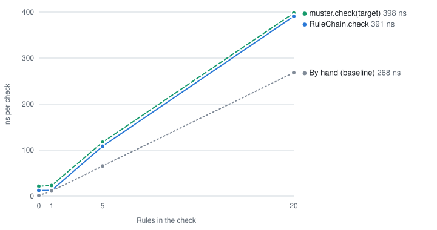

# Benchmarks

What Muster adds to a call, measured with [JMH](https://github.com/openjdk/jmh). The benchmarks
live in [`muster-benchmarks`](../../muster-benchmarks), which is not published.

<picture>
  <source media="(prefers-color-scheme: dark)" srcset="check-cost-dark.svg">
  
</picture>

## Budget

Muster checks and orders the rules of a chain once, when the chain is created, or for
`muster.check(target)` on the first check of each input class. It does no reflection while it
checks. A check that passes is held to this budget, against the same rules called by hand:

| | Measured | Budget |
|---|---|---|
| Fixed cost of `RuleChain.check` | about 12 ns | at most 20 ns |
| Cost that `RuleChain.check` adds with 20 rules | about 117 ns | at most 150 ns |
| Fixed cost of `muster.check(target)` | about 20 ns | at most 35 ns |
| Cost that `muster.check(target)` adds with 20 rules | about 140 ns | at most 235 ns |
| Memory a check allocates | 24 bytes per rule, plus up to 40 | at most 24 bytes per rule, plus 48 |
| Fixed cost of the Spring Boot starter, against calling the same binding by hand | about 132 ns and 96 bytes | at most 200 ns and 128 bytes |

Most of what a rule adds is the context it receives: each rule gets its own, 24 bytes, since it
carries the rule's id. For a passing check the memory figures are exact; the JIT does not vary them.

Most of what the starter costs is Spring AOP's own: a proxy whose advice does nothing, measured the
same way, takes about 85 ns, and the 96 bytes are what Spring AOP allocates for each call: the array
of arguments, a cache key and the method invocation. The starter's advice itself looks up the
method's rules in two maps and allocates nothing.

The numbers hold for the machine described below. A faster machine gives smaller numbers; a change
to Muster is compared with the budget on the same machine.

## Results

The rules do next to nothing, so that the numbers show Muster rather than the rules. Each has a
`check` of its own, as in an application, so the call to it stays virtual. Each cell is the median
of the five forks' average time per check, with the range of the forks within 10% of the median,
and the median of the memory the forks allocate per check.

A check that passes:

| Rules | By hand (baseline) | `RuleChain.check` | `muster.check(target)` |
|---|---|---|---|
| 0 | 1.3 ns (1.3–1.3), 0 B | 13.0 ns (11.9–13.4), 16 B | 21.1 ns (21.1–22.5), 16 B |
| 1 | 11.0 ns (11.0–11.0), 0 B | 12.3 ns (12.3–12.4), 0 B | 22.7 ns (22.6–23.2), 0 B |
| 5 | 65.1 ns (65.0–65.3), 0 B | 106.0 ns (103.7–116.1), 144 B | 115.9 ns (115.1–124.2), 144 B |
| 20 | 265.0 ns (261.0–266.4), 0 B | 381.6 ns (378.3–384.5), 520 B | 404.7 ns (386.3–436.0), 520 B |

With a single rule the JIT inlines the call to it and optimizes the context away, so the check
allocates nothing.

A check of 20 rules that fails, caught as the caller would catch it. The violated rules are spread
evenly, and the last rule is always one of them:

| Violated rules | `FAIL_FAST` | `COLLECT_ALL` |
|---|---|---|
| 1 | 446 ns (423–446), 640 B | 499 ns (487–514), 792 B |
| 5 | 117 ns (112–123), 256 B | 749 ns (731–759), 1,264 B |

`FAIL_FAST` stops at the first violated rule, so with five of them it runs only four rules. The
exception has no stack trace. In this run every fork of a failing check allocated the same.

A failing check is faster than in 0.2.0: measured on the same machine on the same day, with one
violated rule 0.2.0 took 583 ns and 640 bytes with `FAIL_FAST`, and 674 ns and 808 bytes with
`COLLECT_ALL`. The loop over the rules is a method of its own, too large for the JIT to inline,
that returns the violations it found; the small method that throws is inlined into the caller,
which catches the exception without unwinding a frame.

The checks above have no transaction and no method security, so that the numbers show Muster.

### Next to method security and a transaction

The starter's advice on a service method, against the same method with the same other advice that
checks the same rules with a binding by hand. Method security checks a role of the caller in a
`SecurityContext`; the transaction manager has no database, so that the numbers show the
interceptors and their order, not JDBC:

| Other advice | Rules | By hand | With the starter |
|---|---|---|---|
| None | 0 | 25.1 ns (24.8–25.9), 16 B | 157.2 ns (154.4–161.9), 112 B |
| None | 20 | 399.4 ns (398.1–404.2), 520 B | 548.9 ns (540.9–563.4), 616 B |
| Method security | 0 | 2,550 ns (2,522–2,638), 6,096 B | 2,569 ns (2,534–2,599), 6,048 B |
| Method security | 20 | 3,231 ns (3,003–3,324), 6,552 B | 3,120 ns (3,093–3,289), 6,568 B |
| Transaction | 0 | 1,188 ns (1,125–1,215), 712 B | 1,253 ns (1,216–1,292), 712 B |
| Transaction | 20 | 1,609 ns (1,567–1,645), 1,216 B | 1,681 ns (1,663–1,763), 1,216 B |
| Both | 0 | 3,778 ns (3,734–3,846), 6,648 B | 4,063 ns (3,872–4,315), 6,648 B |
| Both | 20 | 4,793 ns (4,548–4,950), 7,152 B | 4,789 ns (4,656–4,933), 7,128 B |

Next to other advice, the starter adds between nothing measurable and about 290 ns, no more than
the forks of one benchmark differ from one another, and no memory: with a transaction both columns
allocate the same, and with method security the memory varies from fork to fork by up to about
300 bytes, more than the starter could add. The proxy and the 96 bytes that Spring AOP
allocates for each call are there anyway.

Spring Security is on the class path of every benchmark of the starter, and the starter reads the
caller from it on each call, so the numbers without other advice are not comparable one to one with
those of 0.2.0; the budget compares them on the same class path.

### A listener

`muster.check(target)` with the listeners of a Muster that the starter configures: none, one that
does nothing, and the starter's observations, with a registry whose handler takes every
observation:

| Listener | No rule | 20 rules |
|---|---|---|
| None | 40.2 ns (40.1–42.9), 16 B | 416.2 ns (415.5–425.9), 520 B |
| One that does nothing | 105.3 ns (105.0–108.7), 72 B | 2,096 ns (2,038–2,134), 576 B |
| Observations | 449.0 ns (448.0–461.3), 776 B | 9,925 ns (9,711–10,034), 15,040 B |

Without a listener, a check pays one null check, and each rule a test of a local that is null; it
takes longer here than in the first table because the starter's Muster reads the caller from Spring
Security and the locale from Spring's `LocaleContextHolder` on each check. A listener that does
nothing adds about 65 ns and 56 bytes to a check, and about 80 ns to each rule. The observations
add about 410 ns and 760 bytes to a check, and about 455 ns and 690 bytes to each rule.

### A collection

A collection checked against 20 rules, each element on its own with `muster.check`, or all at once
with `muster.checkAll`:

| Elements | By hand | `muster.check` on each | `muster.checkAll` |
|---|---|---|---|
| 1 | 293.5 ns (285.3–295.8), 0 B | 401.7 ns (394.8–435.4), 520 B | 929 ns (852–958), 1,768 B |
| 10 | 2,969 ns (2,920–3,015), 0 B | 3,951 ns (3,930–4,309), 5,200 B | 3,850 ns (3,758–3,917), 8,360 B |
| 100 | 28,490 ns (28,351–29,274), 0 B | 39,737 ns (39,235–43,159), 52,000 B | 30,774 ns (30,352–31,004), 75,280 B |

The rules do not override `checkAll`, so Muster checks each element against each rule itself, in a
loop of each rule over the elements. From ten elements on that takes less time than checking each
on its own, since the chain is looked up, the listener asked and the rules walked once: with 100
elements, about 310 ns for each element, against about 400 ns. It allocates more, about 750 bytes
for each element against 520, since the context of each rule carries the element's position, and
the elements each rule passed are kept to skip those that failed in the rules that require it. A
rule that looks up its elements, as in a database, can override `checkAll` to do it with one query
instead of one for each element.

Now and then a fork settles on other compiled code than the others, by hand as well as in Muster,
and nearly always slower code. In this run, seven of the 285 forks ended more than 10% from the
median of their benchmark, all slower, and the ranges above leave them out: one calling 20 rules by
hand (297.1 ns); two of a failing check with one violated rule in `FAIL_FAST` (568.8 and 496.7 ns)
and one in `COLLECT_ALL` (559.8 ns); two of the starter's binding by hand without other advice,
with no rule (29.0 ns) and with one (31.2 ns); and one of the multi-threaded benchmark, whose
results are only in `results.csv`, checking the class bound first to a shared bucket of the chain
map (55.3 ns). The median of five forks keeps such a fork from deciding the published number.

The raw results are in [`results.json`](results.json), and the medians, ranges and the forks more
than 10% from the median in [`results.csv`](results.csv). `./gradlew jmhReport` writes both and the
chart; the tables and the image descriptions here are updated by hand.

## How it was measured

- Intel Core i7-4700HQ (4 cores, 8 threads, 2013), on mains power, frequency fixed at 2.4 GHz:
  the `performance` governor, turbo off
- Linux 7.0, Amazon Corretto 21.0.11, JMH 1.37, Spring Boot 4.0.8 for the starter, with the
  Spring Security and Micrometer that it manages
- Five forks, each with five one-second warm-up iterations and five one-second measurements; the
  published time of a benchmark is the median of its forks' averages
- Allocation from JMH's GC profiler (`-prof gc`)
- A fork more than 10% from the median of its benchmark, as when it settles on other compiled code
  than the others, stays out of the published range and is named above

## Running the benchmarks

[CONTRIBUTING.md](../../CONTRIBUTING.md#benchmarks) says how to run the benchmarks and publish
their results here.
